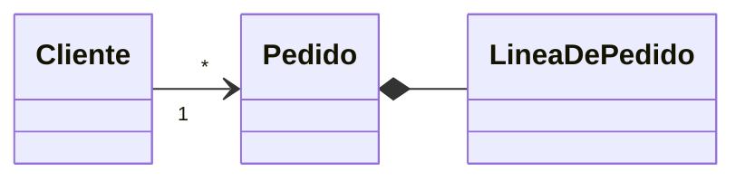

<div class="sig">&gt; ddsi --clase 01<span class="cur"></span></div>

# UML y diagramas de dominio

<div class="sub">Clases, objetos y secuencia: tres formas de contar el mismo sistema</div>

---

# Hoy vemos tres diagramas

<div class="hoy">
  <div v-click class="rise"><div class="h-n">01</div><div class="h-t">Clases</div><div class="h-q">¿Qué hay y cómo se relaciona?</div></div>
  <div v-click class="rise"><div class="h-n">02</div><div class="h-t">Objetos</div><div class="h-q">¿Cómo está el sistema ahora?</div></div>
  <div v-click class="rise"><div class="h-n">03</div><div class="h-t">Secuencia</div><div class="h-q">¿Qué pasa y en qué orden?</div></div>
</div>

<p v-click class="mano rise" style="margin-top: 90px; transform: rotate(-1.5deg); transform-origin: left; font-size: 48px">Si algo no cierra, frená la clase y preguntá.</p>

<!--
Leé las tres preguntas en voz alta, una por una.
Decilo en serio: las dudas se resuelven en el momento, no después del parcial.
-->

---
layout: frase
transition: zoom-soft
---

# UML es un lenguaje común para <span class="r">comunicar un diseño</span>.

<p class="bajada">Cada diagrama muestra una vista distinta del mismo sistema.</p>

---
layout: pregunta
transition: zoom-soft
---

<div class="kicker-mono">›// pensalo con el de al lado</div>

# ¿Alcanza un solo diagrama para explicar un sistema entero?

<div v-click class="resp rise"><strong>No.</strong> Se usan varios, y tienen que ser consistentes entre sí y con el código.</div>

<!--
Dales 20 o 30 segundos antes de revelar la respuesta.
Si nadie contesta, pedí que lo charlen de a dos y preguntá a una mesa cualquiera.
-->

---
transition: slide-up
---

# Dos familias de diagramas

<div class="fam" style="display: grid; grid-template-columns: 1fr 1fr; gap: 52px">
  <div>
    <h2>Estructurales</h2>
    <p class="fam-q">¿Qué hay? Una foto del sistema.</p>
    <ul>
      <li :class="{ usado: $clicks >= 1 }">Clases</li>
      <li :class="{ usado: $clicks >= 1 }">Objetos</li>
      <li>Componentes</li>
      <li>Despliegue</li>
      <li>Paquetes</li>
    </ul>
  </div>
  <div class="der">
    <h2>De comportamiento</h2>
    <p class="fam-q">¿Qué pasa? La película del sistema.</p>
    <ul>
      <li :class="{ usado: $clicks >= 1 }">Secuencia</li>
      <li>Comunicación</li>
      <li>Actividad</li>
      <li>Casos de uso</li>
    </ul>
  </div>
</div>

<p v-click class="small rise" style="margin-top: 20px">En rojo, los que se usan en el primer cuatrimestre.</p>

---
layout: divisor
transition: slide-up
---

<div class="num-big">01</div>
<div class="kicker-mono">›// estructura</div>

# Diagrama de clases

<p class="q">¿Qué elementos hay y cómo se relacionan?</p>

---

# Una clase, tres compartimentos

<div style="display: grid; grid-template-columns: 600px 1fr; gap: 40px; align-items: center">
  <UmlCanvas :w="440" :h="290">
    <ClassBox x="44" y="10" :w="390" name="Pedido"
      :attrs="['- fecha: Fecha', '- estado: Estado', '- cliente: Cliente']"
      :methods="['+ calcularTotal(): Decimal', '+ confirmar(): void']" />
    <g v-click="1"><rect x="44" y="10" width="390" height="56" fill="#b4182d" opacity=".18" /><circle cx="20" cy="38" r="17" fill="#b4182d" /><text x="20" y="46" text-anchor="middle" style="fill:#fff;font-size:24px;font-weight:700">1</text></g>
    <g v-click="2"><rect x="44" y="66" width="390" height="118" fill="#b4182d" opacity=".18" /><circle cx="20" cy="125" r="17" fill="#b4182d" /><text x="20" y="133" text-anchor="middle" style="fill:#fff;font-size:24px;font-weight:700">2</text></g>
    <g v-click="3"><rect x="44" y="184" width="390" height="84" fill="#b4182d" opacity=".18" /><circle cx="20" cy="226" r="17" fill="#b4182d" /><text x="20" y="234" text-anchor="middle" style="fill:#fff;font-size:24px;font-weight:700">3</text></g>
  </UmlCanvas>
  <div style="font-size: 33px; line-height: 1.3">
    <p v-click="1" class="rise"><span class="nb">1</span><strong>Nombre</strong> de la clase</p>
    <p v-click="2" class="rise"><span class="nb">2</span><strong>Atributos:</strong> lo que la clase sabe</p>
    <p v-click="3" class="rise"><span class="nb">3</span><strong>Métodos:</strong> lo que la clase hace</p>
    <p v-click="4" class="rise" style="margin-top: 30px; color: var(--muted); font-size: 28px">Visibilidad: <code>+</code> pública, <code>-</code> privada, <code>#</code> protegida</p>
  </div>
</div>

---

# Tres marcas que cambian el significado

<UmlCanvas :w="1136" :h="170">
  <g v-click="1"><ClassBox x="0" y="4" :w="356" name="MedioDePago" stereotype="interface" :methods="['+ pagar(monto): Boolean']" /></g>
  <g v-click="2"><ClassBox x="390" y="4" :w="356" name="Persona" abstract :attrs="['- nombre: String']" :methods="['+ presentarse(): String']" /></g>
  <g v-click="3"><ClassBox x="780" y="4" :w="356" name="Tienda" :attrs="['- cantidad: Entero {static}']" :methods="['+ abrir(): void {static}']" /></g>
</UmlCanvas>

<div style="display: grid; grid-template-columns: repeat(3, 356px); gap: 34px; font-size: 29px; line-height: 1.3; margin-top: 18px">
  <p v-click="1" class="rise"><strong>Interfaz.</strong> Define qué se puede hacer, sin decir cómo.</p>
  <p v-click="2" class="rise"><strong>Abstracta.</strong> Nombre en cursiva: no se instancia.</p>
  <p v-click="3" class="rise"><strong>Estática.</strong> Subrayado: pertenece a la clase y no a cada objeto.</p>
</div>

---
transition: zoom-soft
---

# Asociación, agregación y composición

<div v-for="r in 3" :key="r" v-click class="from-left" style="display: grid; grid-template-columns: 560px 1fr; gap: 30px; align-items: center; margin-bottom: 46px; font-size: 34px; line-height: 1.3">
  <UmlCanvas v-if="r === 1" :w="560" :h="86">
    <ClassBox x="0" y="12" :w="210" compact name="Cliente" />
    <ClassBox x="350" y="12" :w="210" compact name="Pedido" />
    <Rel from="Cliente" to="Pedido" fm="1" tm="*" />
  </UmlCanvas>
  <UmlCanvas v-else-if="r === 2" :w="560" :h="86">
    <ClassBox x="0" y="12" :w="210" compact name="Catálogo" />
    <ClassBox x="350" y="12" :w="210" compact name="Producto" />
    <Rel from="Catálogo" to="Producto" kind="aggregation" tm="*" />
  </UmlCanvas>
  <UmlCanvas v-else :w="560" :h="86">
    <ClassBox x="0" y="12" :w="210" compact name="Pedido" />
    <ClassBox x="350" y="12" :w="210" compact name="LíneaDePedido" />
    <Rel from="Pedido" to="LíneaDePedido" kind="composition" tm="*" />
  </UmlCanvas>
  <div v-if="r === 1"><strong>Asociación.</strong> Un objeto conoce a otro y puede enviarle mensajes.</div>
  <div v-else-if="r === 2"><strong>Agregación.</strong> Todo y partes: las partes existen sin el todo.</div>
  <div v-else><strong>Composición.</strong> Todo y partes: la parte no existe sin el todo.</div>
</div>

---
layout: pregunta
transition: zoom-soft
---

<div class="kicker-mono">›// ¿agregación o composición?</div>

# Se borra un Pedido. ¿Qué pasa con sus líneas?

<div v-click class="resp rise"><strong>Desaparecen con él.</strong> La línea no existe sin su pedido: composición.</div>

<div v-click class="resp rise">Si se borra el Catálogo, los Productos siguen existiendo: agregación.</div>

<!--
Antes de revelar, preguntá: ¿una línea de pedido tiene sentido sola?
Después del segundo clic, volvé a la diapositiva anterior si hace falta para señalar los rombos.
-->

---

# Herencia, realización y dependencia

<div style="display: grid; grid-template-columns: repeat(3, 1fr); gap: 36px">
  <div v-click class="rise">
    <UmlCanvas :w="340" :h="270">
      <ClassBox x="75" y="6" :w="190" compact name="Persona" />
      <ClassBox x="75" y="196" :w="190" compact name="Empleado" />
      <Rel from="Empleado" to="Persona" fromSide="top" toSide="bottom" kind="generalization" />
    </UmlCanvas>
    <p style="font-size: 29px; line-height: 1.3; margin-top: 12px"><strong>Generalización.</strong> «Es un»: la subclase hereda de la superclase.</p>
  </div>
  <div v-click class="rise">
    <UmlCanvas :w="340" :h="270">
      <ClassBox x="75" y="6" :w="190" compact name="MedioDePago" />
      <ClassBox x="75" y="196" :w="190" compact name="Tarjeta" />
      <Rel from="Tarjeta" to="MedioDePago" fromSide="top" toSide="bottom" kind="realization" />
    </UmlCanvas>
    <p style="font-size: 29px; line-height: 1.3; margin-top: 12px"><strong>Realización.</strong> La clase implementa una interfaz.</p>
  </div>
  <div v-click class="rise">
    <UmlCanvas :w="340" :h="270">
      <ClassBox x="75" y="6" :w="190" compact name="Pedido" />
      <ClassBox x="75" y="196" :w="190" compact name="Correo" />
      <Rel from="Pedido" to="Correo" fromSide="bottom" toSide="top" kind="dependency" />
    </UmlCanvas>
    <p style="font-size: 29px; line-height: 1.3; margin-top: 12px"><strong>Dependencia.</strong> Una clase usa a otra de forma transitoria.</p>
  </div>
</div>

---
transition: slide-left
---

# Multiplicidad: leela de los dos lados

<div style="display: grid; grid-template-columns: 560px 1fr; gap: 56px; align-items: start">
  <div>
    <UmlCanvas :w="560" :h="90">
      <ClassBox x="0" y="14" :w="210" compact name="Cliente" />
      <ClassBox x="350" y="14" :w="210" compact name="Pedido" />
      <Rel from="Cliente" to="Pedido" :kind="$clicks >= 3 ? 'navigable' : 'association'" fm="1" tm="*" />
    </UmlCanvas>
    <div style="font-size: 30px; line-height: 1.3; margin-top: 22px">
      <p v-click="1" class="rise"><strong>¿Un Pedido puede existir sin Cliente?</strong><br>No: el <code>1</code> de ese lado lo impide.</p>
      <p v-click="2" class="rise"><strong>¿Un Cliente puede no tener Pedidos?</strong><br>Sí: el <code>*</code> incluye el cero.</p>
      <p v-click="3" class="rise" style="color: var(--muted); font-size: 27px">Con flecha se indica la navegabilidad: del Cliente se llega a sus Pedidos.</p>
    </div>
  </div>
  <table>
    <tr><th>Notación</th><th>Significa</th></tr>
    <tr><td><code>1</code></td><td>exactamente uno</td></tr>
    <tr><td><code>0..1</code></td><td>cero o uno</td></tr>
    <tr><td><code>*</code></td><td>cero o muchos</td></tr>
    <tr><td><code>1..*</code></td><td>uno o muchos</td></tr>
  </table>
</div>

<!--
Nombrá una clase, ubicate en ella y leé el número que está del otro lado de la línea.
Pedí que alguien lea en voz alta el sentido contrario antes de seguir.
-->

---
layout: error
transition: slide-left
---

<div class="kicker-mono">›// error frecuente</div>

# Multiplicidades al revés

<div class="dos">
  <div>
    <Verdict />
    <UmlCanvas :w="540" :h="96">
      <ClassBox x="0" y="14" :w="190" compact name="Cliente" />
      <ClassBox x="350" y="14" :w="190" compact name="Pedido" />
      <Rel from="Cliente" to="Pedido" fm="*" tm="1" />
    </UmlCanvas>
    <p class="pie-txt">Se lee: un Pedido tiene <strong>muchos Clientes</strong> y un Cliente tiene <strong>un solo Pedido</strong>.</p>
  </div>
  <div v-click class="rise">
    <Verdict ok />
    <UmlCanvas :w="540" :h="96">
      <ClassBox x="0" y="14" :w="190" compact name="Cliente" />
      <ClassBox x="350" y="14" :w="190" compact name="Pedido" />
      <Rel from="Cliente" to="Pedido" fm="1" tm="*" />
    </UmlCanvas>
    <p class="pie-txt">Un Cliente tiene <strong>muchos Pedidos</strong> y cada Pedido pertenece a <strong>un solo Cliente</strong>.</p>
  </div>
</div>

<p v-click class="pie-txt" style="margin-top: 34px; color: var(--muted)">Para chequearlo: pararse en una clase y mirar el número que está del <strong>otro</strong> extremo de la línea.</p>

---

# Casos particulares

<div style="display: grid; grid-template-columns: 1fr 1fr; gap: 40px">
  <div v-click class="rise">
    <UmlCanvas :w="520" :h="190">
      <ClassBox x="30" y="12" :w="240" name="Empleado" :attrs="['- nombre: String']" />
      <Rel from="Empleado" to="Empleado" fromSide="right" toSide="right" :fromAt="0.22" :toAt="0.78" :via="[[360, 40],[360, 110]]" fm="0..1" tm="*" />
      <text x="375" y="82" class="t-lbl halo" style="font-style:italic">dirige a</text>
      <text x="375" y="82" class="t-lbl" style="font-style:italic">dirige a</text>
    </UmlCanvas>
    <p style="font-size: 30px; margin-top: 14px">Una clase puede relacionarse <strong>consigo misma</strong>.</p>
  </div>
  <div v-click class="rise">
    <UmlCanvas :w="520" :h="190">
      <ClassBox x="0" y="12" :w="160" name="Persona" />
      <ClassBox x="360" y="12" :w="160" name="Auto" />
      <Rel from="Persona" to="Auto" :fromAt="0.25" :toAt="0.25" label="es dueña de" />
      <Rel from="Persona" to="Auto" :fromAt="0.75" :toAt="0.75" label="conduce" />
    </UmlCanvas>
    <p style="font-size: 30px; margin-top: 14px">Puede haber <strong>más de una relación</strong> entre dos clases. En ese caso predomina la más fuerte.</p>
  </div>
</div>

---
transition: zoom-soft
---

# Todo junto: un pedido en una tienda

<TpaTag nota="Así se arma un diagrama de dominio en el TPA" />

<UmlCanvas :w="1136" :h="470">
  <ClassBox v-click x="0" y="0" :w="230" name="Cliente" :attrs="['- nombre: String', '- email: String']" />
  <ClassBox v-click x="330" y="0" :w="340" name="Pedido" :attrs="['- fecha: Fecha', '- estado: Estado']" :methods="['+ calcularTotal(): Decimal']" />
  <Rel v-click from="Cliente" to="Pedido" :toAt="0.43" label="realiza" :labelDy="44" fm="1" tm="*" />
  <ClassBox v-click x="330" y="290" :w="340" name="LíneaDePedido" :attrs="['- cantidad: Entero']" :methods="['+ subtotal(): Decimal']" />
  <Rel v-click from="Pedido" to="LíneaDePedido" fromSide="bottom" toSide="top" kind="composition" tm="*" />
  <ClassBox v-click x="0" y="290" :w="230" name="Producto" :attrs="['- nombre: String', '- precio: Decimal']" />
  <Rel v-click from="LíneaDePedido" to="Producto" fromSide="left" toSide="right" :toAt="0.48" kind="navigable" fm="*" tm="1" />
  <ClassBox v-click x="806" y="0" :w="330" name="MedioDePago" stereotype="interface" :methods="['+ pagar(monto): Boolean']" />
  <Rel v-click from="Pedido" to="MedioDePago" :toAt="0.6" kind="navigable" label="paga con" :labelDy="44" tm="1" />
  <ClassBox v-click x="790" y="290" :w="200" name="Tarjeta" :attrs="['- titular: String']" />
  <ClassBox v-click x="1010" y="290" :w="126" name="Efectivo" />
  <Rel v-click from="Tarjeta" to="MedioDePago" fromSide="top" toSide="bottom" :toAt="0.25" kind="realization" />
  <Rel v-click from="Efectivo" to="MedioDePago" fromSide="top" toSide="bottom" :toAt="0.81" kind="realization" />
</UmlCanvas>

---
transition: slide-up
---

<div class="kicker-mono">›// encontrá los errores</div>

# Este diagrama tiene tres errores

<UmlCanvas :w="1136" :h="346">
  <ClassBox x="40" y="10" :w="290" name="Pedido" :attrs="['fecha: Fecha']" :methods="['+ calcularTotal(): Decimal']" />
  <ClassBox x="470" y="10" :w="280" name="LíneaDePedido" :attrs="['- cantidad: Entero']" />
  <Rel from="LíneaDePedido" to="Pedido" fromSide="left" toSide="right" :fromAt="0.6" kind="composition" fm="*" tm="1" />
  <ClassBox x="840" y="10" :w="296" name="MedioDePago" stereotype="interface" :methods="['+ pagar(monto): Boolean']" />
  <ClassBox x="840" y="236" :w="296" name="Tarjeta" :attrs="['- titular: String']" />
  <Rel from="Tarjeta" to="MedioDePago" fromSide="top" toSide="bottom" kind="generalization" />
  <g v-click="1"><circle cx="14" cy="86" r="15" fill="#b4182d" /><text x="14" y="94" text-anchor="middle" style="fill:#fff;font-size:21px;font-weight:700">1</text></g>
  <g v-click="2"><circle cx="452" cy="38" r="15" fill="#b4182d" /><text x="452" y="46" text-anchor="middle" style="fill:#fff;font-size:21px;font-weight:700">2</text></g>
  <g v-click="3"><circle cx="1052" cy="200" r="15" fill="#b4182d" /><text x="1052" y="208" text-anchor="middle" style="fill:#fff;font-size:21px;font-weight:700">3</text></g>
</UmlCanvas>

<div style="font-size: 28px; line-height: 1.32">
  <p v-click="1" class="rise" style="margin: 0 0 6px"><span class="nb">1</span>El atributo <code>fecha</code> no tiene <strong>visibilidad</strong>.</p>
  <p v-click="2" class="rise" style="margin: 0 0 6px"><span class="nb">2</span>El rombo de la composición va del lado del <strong>todo</strong>, no de la parte.</p>
  <p v-click="3" class="rise" style="margin: 0"><span class="nb">3</span>La realización de una interfaz se dibuja con línea <strong>discontinua</strong>.</p>
</div>

<!--
Dales un minuto para buscar los errores antes de hacer el primer clic.
Pedí que pasen al pizarrón a marcar uno cada uno.
-->

---
layout: divisor
transition: slide-up
---

<div class="num-big">02</div>
<div class="kicker-mono">›// estructura</div>

# Diagrama de objetos

<p class="q">¿Cómo está el sistema en este instante?</p>

---

# Dibujá la foto en el pizarrón

<div style="display: grid; grid-template-columns: 430px 1fr; gap: 50px; align-items: start">
  <div>
    <UmlCanvas :w="430" :h="270">
      <ClassBox x="110" y="6" :w="210" compact name="Cliente" />
      <ClassBox x="110" y="200" :w="210" compact name="Pedido" />
      <Rel from="Cliente" to="Pedido" fromSide="bottom" toSide="top" fm="1" tm="*" />
    </UmlCanvas>
    <p style="font-size: 31px; line-height: 1.3; margin-top: 18px">Ana hizo <strong>dos pedidos</strong>: uno el 12/03 y otro el 14/03.</p>
    <p style="font-size: 27px; color: var(--muted)">¿Cómo queda el diagrama de objetos?</p>
  </div>
  <div style="position: relative; min-height: 380px">
    <div v-show="$clicks < 1" style="border: 4px dashed #b9b2b4; border-radius: 14px; height: 380px; display: flex; align-items: center; justify-content: center; color: #8d8789; font-size: 30px">Tu turno</div>
    <div v-click class="rise" style="position: absolute; left: 0; top: 0; width: 100%">
      <UmlCanvas :w="620" :h="340">
        <ClassBox x="180" y="0" :w="260" obj name="ana: Cliente" :attrs="['nombre = &quot;Ana&quot;']" />
        <ClassBox x="0" y="212" :w="290" obj name="p1: Pedido" :attrs="['fecha = 12/03']" />
        <ClassBox x="330" y="212" :w="290" obj name="p2: Pedido" :attrs="['fecha = 14/03']" />
        <Rel from="ana: Cliente" to="p1: Pedido" fromSide="bottom" toSide="top" :fromAt="0.3" :toAt="0.5" kind="link" />
        <Rel from="ana: Cliente" to="p2: Pedido" fromSide="bottom" toSide="top" :fromAt="0.7" :toAt="0.5" kind="link" />
      </UmlCanvas>
    </div>
  </div>
</div>

<!--
Dejá el cuadro vacío y pedí a alguien que pase al pizarrón.
Fijate si escribe el nombre de la clase subrayado y los valores concretos de los atributos.
-->

---
transition: slide-up
---

# Una foto del sistema en un instante

<UmlCanvas :w="1136" :h="506">
  <ClassBox v-click x="0" y="0" :w="270" obj name="ana: Cliente" :attrs="['nombre = &quot;Ana&quot;']" />
  <ClassBox v-click x="370" y="0" :w="330" obj name="pedido1: Pedido" :attrs="['fecha = 12/03', 'estado = PENDIENTE']" />
  <Rel v-click from="ana: Cliente" to="pedido1: Pedido" :toAt="0.38" kind="link" label="realiza" />
  <ClassBox v-click x="190" y="210" :w="330" obj name="l1: LíneaDePedido" :attrs="['cantidad = 2']" />
  <ClassBox v-click x="560" y="210" :w="330" obj name="l2: LíneaDePedido" :attrs="['cantidad = 1']" />
  <Rel v-click from="pedido1: Pedido" to="l1: LíneaDePedido" fromSide="bottom" toSide="top" :fromAt="0.3" :toAt="0.85" kind="link" />
  <Rel v-click from="pedido1: Pedido" to="l2: LíneaDePedido" fromSide="bottom" toSide="top" :fromAt="0.7" :toAt="0.12" kind="link" />
  <ClassBox v-click x="190" y="350" :w="330" obj name="p1: Producto" :attrs="['nombre = &quot;Teclado&quot;', 'precio = 18000']" />
  <ClassBox v-click x="560" y="350" :w="330" obj name="p2: Producto" :attrs="['nombre = &quot;Mouse&quot;', 'precio = 9500']" />
  <Rel v-click from="l1: LíneaDePedido" to="p1: Producto" fromSide="bottom" toSide="top" kind="link" />
  <Rel v-click from="l2: LíneaDePedido" to="p2: Producto" fromSide="bottom" toSide="top" kind="link" />
  <ClassBox v-click x="860" y="17" :w="276" obj name="t1: Tarjeta" :attrs="['titular = &quot;Ana&quot;']" />
  <Rel v-click from="pedido1: Pedido" to="t1: Tarjeta" kind="link" label="paga con" />
</UmlCanvas>

---
layout: divisor
transition: slide-up
---

<div class="num-big">03</div>
<div class="kicker-mono">›// comportamiento</div>

# Diagrama de secuencia

<p class="q">¿Qué pasa, y en qué orden?</p>

---

# Un mismo caso de uso, dos niveles

<div style="display: grid; grid-template-columns: 1fr 1fr; gap: 40px; align-items: start">
  <div v-click class="rise">
    <div class="kicker-mono" style="margin-bottom: 4px">›// nivel dominio</div>
    <SeqDiagram
      :w="540" :rowH="62"
      :participants="[
        { id: 'c', label: 'Cliente', actor: true },
        { id: 'p', label: ':Pedido' },
        { id: 'l', label: ':Producto' },
      ]"
      :messages="[
        { from: 'c', to: 'p', text: 'confirmar()' },
        { from: 'p', to: 'l', text: 'precio()' },
        { from: 'l', to: 'p', text: 'monto', kind: 'return' },
      ]"
      :activations="[{ p: 'p', from: 0, to: 2 }, { p: 'l', from: 1, to: 2 }]"
      :startClick="-100"
    />
  </div>
  <div v-click class="rise">
    <div class="kicker-mono" style="margin-bottom: 4px">›// nivel servicios</div>
    <SeqDiagram
      :w="540" :rowH="62"
      :participants="[
        { id: 'c', label: 'Cliente', actor: true },
        { id: 's', label: ':Pedidos' },
        { id: 'g', label: ':Pagos' },
      ]"
      :messages="[
        { from: 'c', to: 's', text: 'confirmar(id)' },
        { from: 's', to: 'g', text: 'cobrar(monto)' },
        { from: 'g', to: 's', text: 'resultado', kind: 'return' },
      ]"
      :activations="[{ p: 's', from: 0, to: 2 }, { p: 'g', from: 1, to: 2 }]"
      :startClick="-100"
    />
  </div>
</div>

<p v-click class="small rise" style="margin-top: 14px; font-size: 30px; color: var(--ink)">El enunciado indica a cuál se refiere. Si pide <strong>servicios</strong>, no se diagraman objetos del dominio.</p>

<!--
Remarcá que son dos preguntas distintas: qué objetos colaboran, o qué servicios se llaman entre sí.
En parciales ya se pidió a nivel servicios y se respondió con objetos del dominio.
-->

---
transition: slide-left
---

# Anatomía de un diagrama de secuencia

<div style="display: grid; grid-template-columns: 700px 1fr; gap: 36px; align-items: start">
  <SeqDiagram
    :w="760" :rowH="62"
    :participants="[
      { id: 'c', label: 'Cliente', actor: true },
      { id: 'p', label: ':Pedido' },
      { id: 'm', label: ':Correo' },
      { id: 'e', label: ':Envío' },
    ]"
    :messages="[
      { from: 'c', to: 'p', text: 'confirmar()' },
      { from: 'p', to: 'p', text: 'calcularTotal()' },
      { from: 'p', to: 'm', text: 'enviar(mail)', kind: 'async' },
      { from: 'p', to: 'e', text: '', kind: 'create' },
      { from: 'p', to: 'e', text: 'cancelar()', destroy: true },
      { from: 'p', to: 'c', text: 'confirmado', kind: 'return' },
    ]"
    :activations="[{ p: 'p', from: 0, to: 5 }]"
  />
  <ul style="font-size: 31px; line-height: 1.25; padding-top: 6px">
    <li v-click="1" class="rise"><strong>Sincrónico:</strong> espera la respuesta</li>
    <li v-click="2" class="rise"><strong>Mensaje a sí mismo</strong></li>
    <li v-click="3" class="rise"><strong>Asincrónico:</strong> no espera</li>
    <li v-click="4" class="rise"><strong>Creación</strong> de un objeto</li>
    <li v-click="5" class="rise"><strong>Destrucción:</strong> una X</li>
    <li v-click="6" class="rise"><strong>Retorno:</strong> línea punteada</li>
  </ul>
</div>

---
layout: error
transition: slide-left
---

<div class="kicker-mono">›// error frecuente</div>

# Lo asincrónico, dibujado como sincrónico

<div class="dos">
  <div>
    <Verdict />
    <SeqDiagram
      :w="540" :rowH="48"
      :participants="[
        { id: 'c', label: 'Cliente', actor: true },
        { id: 'p', label: ':Pedido' },
        { id: 'm', label: ':Correo' },
      ]"
      :messages="[
        { from: 'c', to: 'p', text: 'confirmar()' },
        { from: 'p', to: 'm', text: 'enviar(mail)' },
        { from: 'm', to: 'p', text: 'ok', kind: 'return' },
        { from: 'p', to: 'c', text: 'confirmado', kind: 'return' },
      ]"
      :activations="[{ p: 'p', from: 0, to: 3 }, { p: 'm', from: 1, to: 2 }]"
      :startClick="-100"
    />
    <p class="pie-txt">El Pedido queda <strong>esperando</strong> al Correo para responder.</p>
  </div>
  <div v-click class="rise">
    <Verdict ok />
    <SeqDiagram
      :w="540" :rowH="48"
      :participants="[
        { id: 'c', label: 'Cliente', actor: true },
        { id: 'p', label: ':Pedido' },
        { id: 'm', label: ':Correo' },
      ]"
      :messages="[
        { from: 'c', to: 'p', text: 'confirmar()' },
        { from: 'p', to: 'm', text: 'enviar(mail)', kind: 'async' },
        { from: 'p', to: 'c', text: 'confirmado', kind: 'return' },
      ]"
      :activations="[{ p: 'p', from: 0, to: 2 }]"
      :startClick="-100"
    />
    <p class="pie-txt">Si no se espera la respuesta: <strong>punta abierta</strong> y sin retorno.</p>
  </div>
</div>

<!--
Mostrá primero el diagrama de la izquierda y preguntá si el Pedido tiene que esperar al Correo.
El asincronismo se retoma con más detalle en la clase de arquitecturas asincrónicas.
-->

---
transition: slide-left
---

# Ejemplo: confirmar un pedido

<TpaTag nota="Los diagramas de secuencia también se piden en el TPA" />

<div style="max-width: 760px; margin: 0 auto">
  <SeqDiagram
    :w="860" :rowH="80"
    :participants="[
      { id: 'c', label: 'Cliente', actor: true },
      { id: 'p', label: ':Pedido' },
      { id: 'l', label: ':LíneaDePedido' },
      { id: 'm', label: ':MedioDePago' },
    ]"
    :messages="[
      { from: 'c', to: 'p', text: 'confirmar()' },
      { from: 'p', to: 'l', text: 'subtotal()' },
      { from: 'l', to: 'p', text: 'monto', kind: 'return' },
      { from: 'p', to: 'm', text: 'pagar(total)' },
      { from: 'm', to: 'p', text: 'true', kind: 'return' },
    ]"
    :activations="[{ p: 'p', from: 0, to: 4 }, { p: 'l', from: 1, to: 2 }, { p: 'm', from: 3, to: 4 }]"
    :fragments="[{ op: 'loop', guard: '[por cada línea]', from: 1, to: 2, p1: 'p', p2: 'l' }]"
  />
</div>

---
layout: error
transition: slide-left
---

<div class="kicker-mono">›// error frecuente</div>

# Parámetros vacíos y datos que salen de la nada

<div class="dos">
  <div>
    <Verdict />
    <SeqDiagram
      :w="560" :rowH="50" :labelSize="22"
      :participants="[
        { id: 'c', label: 'Cliente', actor: true },
        { id: 'p', label: ':Pedido' },
        { id: 'm', label: ':MedioDePago' },
      ]"
      :messages="[
        { from: 'c', to: 'p', text: 'confirmar()' },
        { from: 'p', to: 'm', text: 'pagar()' },
        { from: 'm', to: 'p', text: 'true', kind: 'return' },
      ]"
      :activations="[{ p: 'p', from: 0, to: 2 }, { p: 'm', from: 1, to: 2 }]"
      :startClick="-100"
    />
    <p class="pie-txt"><span class="nb">1</span><code>pagar()</code>: ¿cuánto se paga?</p>
  </div>
  <div v-click class="rise">
    <Verdict ok />
    <SeqDiagram
      :w="560" :rowH="58" :labelSize="22"
      :participants="[
        { id: 'c', label: 'Cliente', actor: true },
        { id: 'p', label: ':Pedido' },
        { id: 'm', label: ':MedioDePago' },
      ]"
      :messages="[
        { from: 'c', to: 'p', text: 'confirmar()' },
        { from: 'p', to: 'p', text: 'calcularTotal()' },
        { from: 'p', to: 'm', text: 'pagar(total)' },
        { from: 'm', to: 'p', text: 'true', kind: 'return' },
      ]"
      :activations="[{ p: 'p', from: 0, to: 3 }, { p: 'm', from: 2, to: 3 }]"
      :startClick="-100"
    />
    <p class="pie-txt"><span class="nb">2</span>Cada dato se <strong>obtiene antes</strong> de usarlo.</p>
  </div>
</div>

<!--
Si en tu diagrama aparece un valor, preguntate de dónde sale: del enunciado, de otro objeto o de la base de datos.
Los parámetros nunca se dejan vacíos si el método necesita un dato.
-->

---

<div class="dato-fila">
  <div class="dato-n">3</div>
  <div class="dato-t">diagramas para el primer cuatrimestre: <strong>clases, objetos y secuencia</strong>.
    <small>Siempre, como mínimo, uno de clases y uno de secuencia. Los parcialitos teóricos se complementan con ellos: conviene estudiarlos desde ahora.</small>
  </div>
</div>

---
transition: zoom-soft
---

# Antes de entregar un diagrama

<ul style="font-size: 39px; line-height: 1.35">
  <li v-click class="rise"><strong>Nombres claros</strong> en clases, mensajes y componentes.</li>
  <li v-click class="rise"><strong>Parámetros completos</strong> en cada método.</li>
  <li v-click class="rise"><strong>Completar con el enunciado</strong> todo lo que diga.</li>
  <li v-click class="rise">Si algo no está claro, <strong>una nota explicativa</strong>.</li>
  <li v-click class="rise"><strong>Coherencia</strong> entre los diagramas y con la implementación.</li>
</ul>

---
layout: frase
transition: zoom-soft
---

# No hay una única solución correcta. Pero <span class="r">mezclar técnicas</span> y perder coherencia sí es incorrecto.

---

# Dónde diagramar

<ul style="font-size: 42px; line-height: 1.35">
  <li v-click class="rise"><strong>Draw.io:</strong> gratuito, desde el navegador.</li>
  <li v-click class="rise"><strong>Lucidchart:</strong> diagramas en línea.</li>
  <li v-click class="rise"><strong>Miro:</strong> pizarra colaborativa.</li>
</ul>

<p v-click class="small rise" style="margin-top: 26px; font-size: 30px; color: var(--ink)">También se puede escribir el diagrama como código, con <strong>Mermaid</strong>.</p>

---

# Mermaid: el diagrama como texto

<div style="display: grid; grid-template-columns: 0.85fr 1.15fr; gap: 30px; align-items: center">

```md
classDiagram
  direction LR
  Cliente "1" --> "*" Pedido
  Pedido *-- LineaDePedido
```



</div>

<p class="small" style="margin-top: 18px">Se escribe texto y se obtiene el diagrama. Es más complejo de usar que un software de diagramado.</p>

---
transition: zoom-soft
---

# Referencias

<ul class="refs">
  <li>Booch, G., Rumbaugh, J. y Jacobson, I. <em>El lenguaje unificado de modelado</em> (2.ª ed.).</li>
  <li>Rumbaugh, J., Jacobson, I. y Booch, G. <em>El lenguaje unificado de modelado: manual de referencia</em> (2.ª ed.).</li>
  <li>Alhir, S. S. <em>Learning UML</em>. O'Reilly.</li>
  <li>Object Management Group. <em>About the Unified Modeling Language</em>.</li>
  <li>Wikipedia. <em>List of Unified Modeling Language tools</em>.</li>
</ul>

---
layout: center
transition: zoom-soft
---

# ¡Gracias!

<p class="mano" style="margin-top: 26px; transform: rotate(-2deg)">Lo que no cerró hoy, preguntalo hoy.</p>

<p class="small" style="margin-top: 34px">Apunte de la clase: <a href="apunte.pdf">apunte.pdf</a></p>
