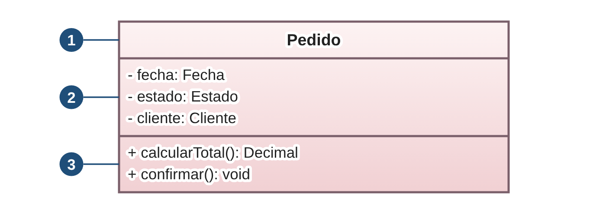
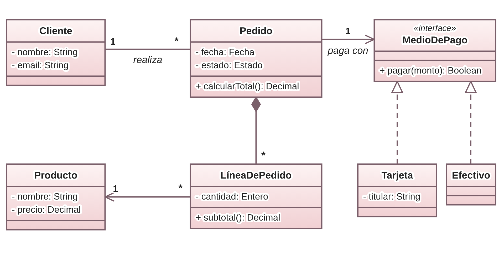
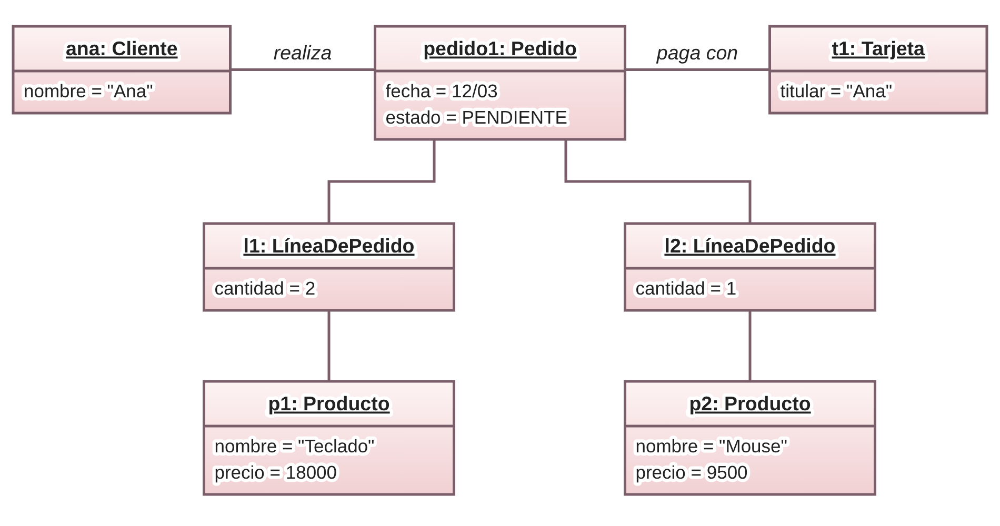
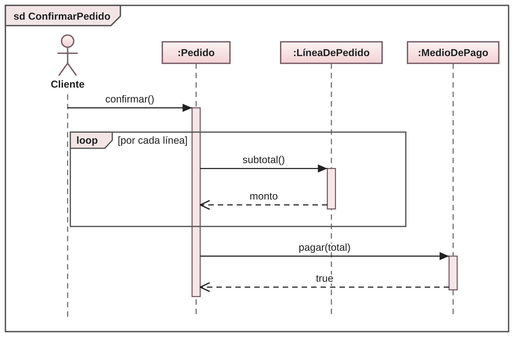

# UML y diagramas de dominio

## Objetivo

Comprender qué es UML y utilizar los tres diagramas que se emplean en el primer cuatrimestre del curso: el diagrama de clases, el diagrama de objetos y el diagrama de secuencia.

## Introducción

Diseñar un sistema implica pensar en sus partes, en cómo se relacionan y en cómo colaboran para resolver un problema. Para comunicar ese diseño a otras personas, y también para ordenar las propias ideas, se necesita un lenguaje común. Ese es el papel de UML.

En este apunte se presentan los conceptos generales de UML y, a continuación, los tres diagramas que se utilizan en el curso. Todos los ejemplos pertenecen al mismo dominio: un pedido en una tienda.

## ¿Qué es UML?

**UML** es un lenguaje común para visualizar, especificar, construir y documentar las distintas partes de un sistema. Proporciona el vocabulario y las reglas para comunicar un diseño. Coloquialmente se lo asocia con "los diagramas", aunque el lenguaje es más amplio que ellos.

Es importante tener en cuenta que:

- Cada diagrama ofrece una vista distinta del mismo sistema. No es posible representar todo el sistema con un único diagrama.
- Todos los diagramas tienen un nombre que los identifica, y se deben generar tantos como sean necesarios.
- Los diagramas deben ser consistentes entre sí y con la implementación.

La especificación vigente (UML 2.5.1) define catorce tipos de diagramas, agrupados en dos familias.

- **Diagramas estructurales:** describen los elementos del sistema y las relaciones entre ellos. Se los llama estáticos porque no describen el comportamiento a lo largo del tiempo. Son los diagramas de clases, de objetos, de componentes, de despliegue y de paquetes, entre otros.
- **Diagramas de comportamiento:** describen cómo se comporta el sistema y cómo interactúan sus elementos a lo largo del tiempo. Se los llama dinámicos. Son los diagramas de secuencia, de comunicación, de actividad y de casos de uso, entre otros.

En el primer cuatrimestre se utilizan tres: el diagrama de clases y el diagrama de objetos, que son estructurales, y el diagrama de secuencia, que es de comportamiento.

## ¿Qué es un diagrama de clases?

El **diagrama de clases** permite visualizar la estructura de las clases que componen el sistema: sus atributos, sus métodos y las relaciones entre ellas.

### Elementos principales

Cada clase se representa con un rectángulo dividido en tres compartimentos, como se observa en la Figura 1.

Comenzando desde arriba, los compartimentos son:

1. **Nombre:** identifica a la clase.
2. **Atributos:** representan lo que la clase sabe. Se escriben como `visibilidad nombre: Tipo`.
3. **Métodos:** representan lo que la clase hace. Se escriben como `visibilidad nombre(parámetros): Tipo de retorno`.

La **visibilidad** indica desde dónde se puede acceder a un miembro: `+` pública, `-` privada y `#` protegida.

Algunos elementos agregan información a la clase:

- **Interfaz:** se indica con el estereotipo «interface» sobre el nombre. Define qué se puede hacer, sin decir cómo.
- **Clase abstracta:** se escribe el nombre en cursiva. No se puede instanciar.
- **Miembro estático:** se subraya. Pertenece a la clase y no a cada una de sus instancias.

### Relaciones entre clases

Las relaciones indican cómo se vinculan las clases entre sí. En la Tabla 1 se resumen las que se utilizan en el curso.

| Relación | Notación | Significado |
| --- | --- | --- |
| Asociación | Línea continua | Un objeto conoce a otro y puede enviarle mensajes. |
| Agregación | Línea con rombo vacío del lado del todo | Relación todo-parte en la que las partes pueden existir sin el todo. |
| Composición | Línea con rombo lleno del lado del todo | Relación todo-parte en la que la parte no puede existir sin el todo. |
| Generalización | Línea continua con triángulo vacío hacia la superclase | La subclase "es un" caso particular de la superclase y hereda de ella. |
| Realización | Línea discontinua con triángulo vacío hacia la interfaz | La clase implementa los métodos de una interfaz. |
| Dependencia | Línea discontinua con flecha abierta | Una clase usa a otra de forma transitoria, por ejemplo como parámetro o variable local. |

*Tabla 1. Relaciones entre clases.*

Una clase puede relacionarse consigo misma, y puede haber más de una relación entre dos clases. En ese caso, predomina la relación más fuerte.

### Multiplicidad y navegabilidad

En los extremos de una asociación se indica la **multiplicidad**, es decir, cuántos objetos participan de la relación. Las notaciones más frecuentes son `1` (exactamente uno), `0..1` (cero o uno), `*` (cero o muchos) y `1..*` (uno o muchos).

La **navegabilidad** se indica con una flecha abierta y señala qué clase conoce a cuál. Por ejemplo, si un Cliente conoce a sus Pedidos pero un Pedido no conoce a su Cliente, la flecha apunta hacia Pedido.

### Ejemplo

En la Figura 2 se representa el dominio de una tienda. Comenzando desde la izquierda, un Cliente realiza muchos Pedidos. Cada Pedido se compone de líneas de pedido, que no existen sin él, y cada línea hace referencia a un Producto. Siguiendo hacia la derecha, el Pedido se paga con un medio de pago. A continuación, se observa que MedioDePago es una interfaz y que Tarjeta y Efectivo la realizan. Por lo tanto, el Pedido puede tratar a ambas de manera polimórfica sin conocer cuál es la concreta.

## ¿Qué es un diagrama de objetos?

El **diagrama de objetos** modela el sistema en un momento y con un estado concretos. Es como sacarle una foto al sistema en un instante de tiempo.

### Elementos principales

- **Objetos:** instancias que existen en ese instante. Se rotulan con `nombre: Tipo` subrayado y muestran los valores de sus atributos.
- **Enlaces:** relaciones entre los objetos. Son instancias de las asociaciones del diagrama de clases.

En la Figura 3 se muestra una posible foto del sistema de la Figura 2. Comenzando desde la izquierda, el objeto ana es un Cliente que realiza el pedido1. Este pedido contiene dos líneas, una por cada producto, y se paga con la tarjeta t1.

## ¿Qué es un diagrama de secuencia?

El **diagrama de secuencia** permite visualizar una interacción particular entre objetos. Se destacan el orden y la temporalidad de los mensajes enviados y recibidos.

### Elementos principales

- **Línea de vida:** representa la existencia de un participante a lo largo del tiempo. Se dibuja como una línea vertical discontinua debajo de su cabecera.
- **Activación:** rectángulo sobre la línea de vida que indica el período en el que el participante está ejecutando una operación.
- **Mensajes:** comunicaciones entre participantes. Se rotulan con el nombre de la operación y sus argumentos, por ejemplo `pagar(total)`.

El tiempo transcurre de arriba hacia abajo. Importa el orden de los mensajes sobre cada línea de vida; la distancia entre ellos no tiene significado.

### Tipos de mensaje

- **Sincrónico:** línea continua con punta rellena. El emisor espera la respuesta antes de continuar.
- **Asincrónico:** línea continua con punta abierta. El emisor continúa sin esperar.
- **Respuesta:** línea discontinua con punta abierta. Devuelve el control o un resultado al emisor.
- **A sí mismo:** el mensaje sale de una línea de vida y vuelve a la misma.
- **Creación:** línea discontinua con punta abierta que llega a la cabecera del objeto nuevo, con el estereotipo «create».
- **Destrucción:** una X al final de la línea de vida del objeto destruido.

### Elementos de control

Las estructuras de control se representan con **fragmentos**, rectángulos que enmarcan una parte de la interacción y llevan un operador en la esquina superior izquierda:

- **loop:** repite el contenido mientras se cumpla la guarda, escrita entre corchetes.
- **alt:** representa alternativas. Se ejecuta a lo sumo uno de los operandos, el primero cuya guarda es verdadera, y `[else]` cubre el caso contrario.
- **opt:** el contenido se ejecuta solo si la guarda es verdadera.

### Ejemplo

En la Figura 4 se representa la confirmación de un pedido. Comenzando desde la izquierda, el Cliente envía el mensaje `confirmar()` al Pedido. A continuación, el Pedido calcula el total: por cada línea, le pide su subtotal y recibe el monto como respuesta, lo que se indica con el fragmento loop. Por último, el Pedido envía `pagar(total)` al medio de pago y recibe `true` como respuesta.

## Consideraciones para el curso

- En el primer cuatrimestre se deben dominar el diagrama de clases, el de objetos y el de secuencia. Siempre se realiza, como mínimo, un diagrama de clases y uno de secuencia.
- Los nombres de los mensajes y de los componentes deben ser claros, y los parámetros de los métodos no se deben dejar vacíos.
- Con la información que brinda el enunciado se debe intentar completar los diagramas. En todos ellos se pueden sumar notas explicativas.
- UML es flexible y no existe una única solución correcta. Sin embargo, si se mezclan técnicas y se pierde coherencia, es probable que la solución no sea correcta.
- Los parcialitos teóricos se complementan con estos diagramas, por lo que se recomienda tenerlos bien estudiados desde ahora.

### Herramientas para diagramar

Se recomienda utilizar un software de diagramado, como Draw.io, Lucidchart o Miro. También es posible utilizar lenguajes de marcado ligero y de modelado, como Mermaid, que permite escribir el diagrama como texto. Resulta más complejo de utilizar que un software de diagramado.

## Resumen

UML es un lenguaje común para comunicar un diseño, y cada uno de sus diagramas ofrece una vista distinta del mismo sistema. El diagrama de clases describe la estructura: clases, atributos, métodos y relaciones. El diagrama de objetos muestra una foto del sistema en un instante, con objetos y enlaces concretos. El diagrama de secuencia describe una interacción entre objetos a lo largo del tiempo mediante mensajes. Los tres deben ser claros, coherentes entre sí y consistentes con la implementación.

## Referencias

- Booch, G., Rumbaugh, J. y Jacobson, I. *El lenguaje unificado de modelado* (2.ª ed.).
- Rumbaugh, J., Jacobson, I. y Booch, G. *El lenguaje unificado de modelado: manual de referencia* (2.ª ed.).
- Alhir, S. S. (2003). *Learning UML*. O'Reilly.
- Object Management Group. (2017). *OMG Unified Modeling Language (OMG UML), versión 2.5.1* (formal/17-12-05).
