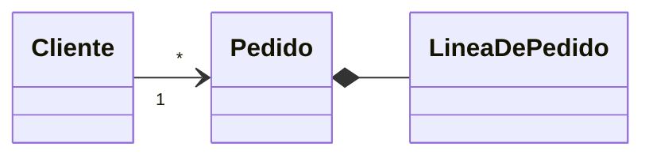

<div class="kicker">Clase 1</div>

# UML y Diagramas de Dominio

<div class="sub">Lenguaje unificado de modelado: diagramas de clases, de objetos y de secuencia</div>

---

# ¿Qué es UML?

<p class="lead">Un lenguaje común para comunicar un diseño.</p>

<div class="cards c4">
  <div v-click class="card"><span class="big">Visualizar</span>lo que se piensa</div>
  <div v-click class="card"><span class="big">Especificar</span>con reglas claras</div>
  <div v-click class="card"><span class="big">Construir</span>a partir del modelo</div>
  <div v-click class="card"><span class="big">Documentar</span>las decisiones</div>
</div>

<div class="cards c3" style="margin-top: 26px">
  <div v-click class="card gris">Cada diagrama muestra una <strong>vista distinta</strong> del mismo sistema</div>
  <div v-click class="card gris">Ningún diagrama alcanza para <strong>representarlo todo</strong></div>
  <div v-click class="card gris">Los diagramas son <strong>consistentes</strong> entre sí y con el código</div>
</div>

---

# Dos familias de diagramas

<div class="cards c2">
  <div class="card">
    <span class="big">Estructurales</span>
    <span class="small">¿Qué elementos hay y cómo se relacionan? Una foto del sistema.</span>
    <div style="margin-top: 14px">
      <span class="chip" :class="{ on: $clicks >= 1 }">Clases</span>
      <span class="chip" :class="{ on: $clicks >= 1 }">Objetos</span>
      <span class="chip">Componentes</span>
      <span class="chip">Despliegue</span>
      <span class="chip">Paquetes</span>
    </div>
  </div>
  <div class="card gris">
    <span class="big" style="color: var(--ink)">De comportamiento</span>
    <span class="small">¿Qué pasa a lo largo del tiempo? La película del sistema.</span>
    <div style="margin-top: 14px">
      <span class="chip" :class="{ on: $clicks >= 1 }">Secuencia</span>
      <span class="chip">Comunicación</span>
      <span class="chip">Actividad</span>
      <span class="chip">Casos de uso</span>
    </div>
  </div>
</div>

<p v-click class="lead" style="margin-top: 34px">En rojo, los tres que se usan en el primer cuatrimestre.</p>

---
layout: section
---

<div class="kicker">Estructura</div>

# Diagrama de clases

---

# Anatomía de una clase

<div style="display: grid; grid-template-columns: 600px 1fr; gap: 40px; align-items: center">
  <UmlCanvas :w="440" :h="290">
    <ClassBox x="44" y="10" :w="390" name="Pedido"
      :attrs="['- fecha: Fecha', '- estado: Estado', '- cliente: Cliente']"
      :methods="['+ calcularTotal(): Decimal', '+ confirmar(): void']" />
    <g v-click="1"><rect x="44" y="10" width="390" height="56" fill="#b4182d" opacity=".18" /><circle cx="20" cy="38" r="17" fill="#b4182d" /><text x="20" y="46" text-anchor="middle" style="fill:#fff;font-size:24px;font-weight:700">1</text></g>
    <g v-click="2"><rect x="44" y="66" width="390" height="118" fill="#b4182d" opacity=".18" /><circle cx="20" cy="125" r="17" fill="#b4182d" /><text x="20" y="133" text-anchor="middle" style="fill:#fff;font-size:24px;font-weight:700">2</text></g>
    <g v-click="3"><rect x="44" y="184" width="390" height="84" fill="#b4182d" opacity=".18" /><circle cx="20" cy="226" r="17" fill="#b4182d" /><text x="20" y="234" text-anchor="middle" style="fill:#fff;font-size:24px;font-weight:700">3</text></g>
  </UmlCanvas>
  <div>
    <div v-click="1" class="card" style="margin-bottom: 14px"><strong>1 · Nombre</strong> de la clase</div>
    <div v-click="2" class="card" style="margin-bottom: 14px"><strong>2 · Atributos:</strong> lo que la clase sabe</div>
    <div v-click="3" class="card" style="margin-bottom: 14px"><strong>3 · Métodos:</strong> lo que la clase hace</div>
    <div v-click="4" class="card gris"><strong>Visibilidad:</strong> <strong>+</strong> pública, <strong>-</strong> privada, <strong>#</strong> protegida</div>
  </div>
</div>

---

# Estereotipos y modificadores

<div class="cards c3" style="align-items: start">
  <div v-click>
    <UmlCanvas :w="340" :h="175">
      <ClassBox x="5" y="8" :w="330" name="MedioDePago" stereotype="interface" :methods="['+ pagar(monto): Boolean']" />
    </UmlCanvas>
    <div class="card" style="margin-top: 14px"><strong>Interfaz.</strong> Define qué se puede hacer, sin decir cómo.</div>
  </div>
  <div v-click>
    <UmlCanvas :w="340" :h="175">
      <ClassBox x="5" y="8" :w="330" name="Persona" abstract :attrs="['- nombre: String']" :methods="['+ presentarse(): String']" />
    </UmlCanvas>
    <div class="card" style="margin-top: 14px"><strong>Abstracta.</strong> Nombre en cursiva: no se instancia.</div>
  </div>
  <div v-click>
    <UmlCanvas :w="340" :h="175">
      <ClassBox x="5" y="8" :w="330" name="Tienda" :attrs="['- cantidad: Entero {static}']" :methods="['+ abrir(): void {static}']" />
    </UmlCanvas>
    <div class="card" style="margin-top: 14px"><strong>Estática.</strong> Subrayado: pertenece a la clase.</div>
  </div>
</div>

---

# Relaciones entre clases · I

<div v-for="r in 3" :key="r" v-click style="display: grid; grid-template-columns: 560px 1fr; gap: 30px; align-items: center; margin-bottom: 30px; font-size: 32px; line-height: 1.3">
  <UmlCanvas v-if="r === 1" :w="560" :h="86">
    <ClassBox x="0" y="12" :w="210" compact name="Cliente" />
    <ClassBox x="350" y="12" :w="210" compact name="Pedido" />
    <Rel from="Cliente" to="Pedido" fm="1" tm="*" />
  </UmlCanvas>
  <UmlCanvas v-else-if="r === 2" :w="560" :h="86">
    <ClassBox x="0" y="12" :w="210" compact name="Catálogo" />
    <ClassBox x="350" y="12" :w="210" compact name="Producto" />
    <Rel from="Catálogo" to="Producto" kind="aggregation" tm="*" />
  </UmlCanvas>
  <UmlCanvas v-else :w="560" :h="86">
    <ClassBox x="0" y="12" :w="210" compact name="Pedido" />
    <ClassBox x="350" y="12" :w="210" compact name="LíneaDePedido" />
    <Rel from="Pedido" to="LíneaDePedido" kind="composition" tm="*" />
  </UmlCanvas>
  <div v-if="r === 1"><strong>Asociación.</strong> Un objeto conoce a otro y puede enviarle mensajes.</div>
  <div v-else-if="r === 2"><strong>Agregación.</strong> Todo y partes: las partes existen sin el todo.</div>
  <div v-else><strong>Composición.</strong> Todo y partes: la parte no existe sin el todo.</div>
</div>

---

# Relaciones entre clases · II

<div v-for="r in 3" :key="r" v-click style="display: grid; grid-template-columns: 560px 1fr; gap: 30px; align-items: center; margin-bottom: 30px; font-size: 32px; line-height: 1.3">
  <UmlCanvas v-if="r === 1" :w="560" :h="86">
    <ClassBox x="0" y="12" :w="210" compact name="Empleado" />
    <ClassBox x="350" y="12" :w="210" compact name="Persona" />
    <Rel from="Empleado" to="Persona" kind="generalization" />
  </UmlCanvas>
  <UmlCanvas v-else-if="r === 2" :w="560" :h="86">
    <ClassBox x="0" y="12" :w="210" compact name="Tarjeta" />
    <ClassBox x="350" y="12" :w="210" compact name="MedioDePago" />
    <Rel from="Tarjeta" to="MedioDePago" kind="realization" />
  </UmlCanvas>
  <UmlCanvas v-else :w="560" :h="86">
    <ClassBox x="0" y="12" :w="210" compact name="Pedido" />
    <ClassBox x="350" y="12" :w="210" compact name="Correo" />
    <Rel from="Pedido" to="Correo" kind="dependency" />
  </UmlCanvas>
  <div v-if="r === 1"><strong>Generalización.</strong> «Es un»: la subclase hereda de la superclase.</div>
  <div v-else-if="r === 2"><strong>Realización.</strong> La clase implementa una interfaz.</div>
  <div v-else><strong>Dependencia.</strong> Una clase usa a otra de forma transitoria.</div>
</div>

---

# Multiplicidad y navegabilidad

<div style="display: grid; grid-template-columns: 560px 1fr; gap: 50px; align-items: center">
  <div>
    <UmlCanvas :w="560" :h="90">
      <ClassBox x="0" y="14" :w="210" compact name="Cliente" />
      <ClassBox x="350" y="14" :w="210" compact name="Pedido" />
      <Rel from="Cliente" to="Pedido" kind="navigable" fm="1" tm="*" />
    </UmlCanvas>
    <p v-click class="small" style="margin-top: 22px">La flecha indica que el <strong>Cliente conoce a sus Pedidos</strong>, pero el Pedido no conoce al Cliente.</p>
  </div>
  <table>
    <tr><th>Notación</th><th>Significa</th></tr>
    <tr v-click><td><code>1</code></td><td>exactamente uno</td></tr>
    <tr v-click><td><code>0..1</code></td><td>cero o uno</td></tr>
    <tr v-click><td><code>*</code></td><td>cero o muchos</td></tr>
    <tr v-click><td><code>1..*</code></td><td>uno o muchos</td></tr>
  </table>
</div>

---

# Casos particulares

<div style="display: grid; grid-template-columns: 1fr 1fr; gap: 40px">
  <div v-click>
    <UmlCanvas :w="520" :h="190">
      <ClassBox x="30" y="12" :w="240" name="Empleado" :attrs="['- nombre: String']" />
      <Rel from="Empleado" to="Empleado" fromSide="right" toSide="right" :fromAt="0.22" :toAt="0.78" :via="[[360, 40],[360, 110]]" fm="0..1" tm="*" />
      <text x="375" y="82" class="t-lbl halo" style="font-style:italic">dirige a</text>
      <text x="375" y="82" class="t-lbl" style="font-style:italic">dirige a</text>
    </UmlCanvas>
    <div class="card" style="margin-top: 14px">Una clase puede relacionarse <strong>consigo misma</strong>.</div>
  </div>
  <div v-click>
    <UmlCanvas :w="520" :h="190">
      <ClassBox x="0" y="12" :w="160" name="Persona" />
      <ClassBox x="360" y="12" :w="160" name="Auto" />
      <Rel from="Persona" to="Auto" :fromAt="0.25" :toAt="0.25" label="es dueña de" />
      <Rel from="Persona" to="Auto" :fromAt="0.75" :toAt="0.75" label="conduce" />
    </UmlCanvas>
    <div class="card" style="margin-top: 14px">Puede haber <strong>más de una relación</strong> entre dos clases. En ese caso predomina la más fuerte.</div>
  </div>
</div>

---

# Ejemplo: un pedido en una tienda

<UmlCanvas :w="1136" :h="470">
  <ClassBox v-click x="0" y="0" :w="230" name="Cliente" :attrs="['- nombre: String', '- email: String']" />
  <ClassBox v-click x="330" y="0" :w="340" name="Pedido" :attrs="['- fecha: Fecha', '- estado: Estado']" :methods="['+ calcularTotal(): Decimal']" />
  <Rel v-click from="Cliente" to="Pedido" :toAt="0.43" label="realiza" :labelDy="44" fm="1" tm="*" />
  <ClassBox v-click x="330" y="290" :w="340" name="LíneaDePedido" :attrs="['- cantidad: Entero']" :methods="['+ subtotal(): Decimal']" />
  <Rel v-click from="Pedido" to="LíneaDePedido" fromSide="bottom" toSide="top" kind="composition" tm="*" />
  <ClassBox v-click x="0" y="290" :w="230" name="Producto" :attrs="['- nombre: String', '- precio: Decimal']" />
  <Rel v-click from="LíneaDePedido" to="Producto" fromSide="left" toSide="right" :toAt="0.48" kind="navigable" fm="*" tm="1" />
  <ClassBox v-click x="806" y="0" :w="330" name="MedioDePago" stereotype="interface" :methods="['+ pagar(monto): Boolean']" />
  <Rel v-click from="Pedido" to="MedioDePago" :toAt="0.6" kind="navigable" label="paga con" :labelDy="44" tm="1" />
  <ClassBox v-click x="790" y="290" :w="200" name="Tarjeta" :attrs="['- titular: String']" />
  <ClassBox v-click x="1010" y="290" :w="126" name="Efectivo" />
  <Rel v-click from="Tarjeta" to="MedioDePago" fromSide="top" toSide="bottom" :toAt="0.25" kind="realization" />
  <Rel v-click from="Efectivo" to="MedioDePago" fromSide="top" toSide="bottom" :toAt="0.81" kind="realization" />
</UmlCanvas>

---
layout: section
---

<div class="kicker">Estructura</div>

# Diagrama de objetos

---

# Una foto del sistema en un instante

<UmlCanvas :w="1136" :h="506">
  <ClassBox v-click x="0" y="0" :w="270" obj name="ana: Cliente" :attrs="['nombre = &quot;Ana&quot;']" />
  <ClassBox v-click x="370" y="0" :w="330" obj name="pedido1: Pedido" :attrs="['fecha = 12/03', 'estado = PENDIENTE']" />
  <Rel v-click from="ana: Cliente" to="pedido1: Pedido" :toAt="0.38" kind="link" label="realiza" />
  <ClassBox v-click x="190" y="210" :w="330" obj name="l1: LíneaDePedido" :attrs="['cantidad = 2']" />
  <ClassBox v-click x="560" y="210" :w="330" obj name="l2: LíneaDePedido" :attrs="['cantidad = 1']" />
  <Rel v-click from="pedido1: Pedido" to="l1: LíneaDePedido" fromSide="bottom" toSide="top" :fromAt="0.3" :toAt="0.85" kind="link" />
  <Rel v-click from="pedido1: Pedido" to="l2: LíneaDePedido" fromSide="bottom" toSide="top" :fromAt="0.7" :toAt="0.12" kind="link" />
  <ClassBox v-click x="190" y="350" :w="330" obj name="p1: Producto" :attrs="['nombre = &quot;Teclado&quot;', 'precio = 18000']" />
  <ClassBox v-click x="560" y="350" :w="330" obj name="p2: Producto" :attrs="['nombre = &quot;Mouse&quot;', 'precio = 9500']" />
  <Rel v-click from="l1: LíneaDePedido" to="p1: Producto" fromSide="bottom" toSide="top" kind="link" />
  <Rel v-click from="l2: LíneaDePedido" to="p2: Producto" fromSide="bottom" toSide="top" kind="link" />
  <ClassBox v-click x="860" y="17" :w="276" obj name="t1: Tarjeta" :attrs="['titular = &quot;Ana&quot;']" />
  <Rel v-click from="pedido1: Pedido" to="t1: Tarjeta" kind="link" label="paga con" />
</UmlCanvas>

---
layout: section
---

<div class="kicker">Comportamiento</div>

# Diagrama de secuencia

---

# Anatomía de un diagrama de secuencia

<div style="display: grid; grid-template-columns: 700px 1fr; gap: 36px; align-items: start">
  <SeqDiagram
    :w="760" :rowH="62"
    :participants="[
      { id: 'c', label: 'Cliente', actor: true },
      { id: 'p', label: ':Pedido' },
      { id: 'm', label: ':Correo' },
      { id: 'e', label: ':Envío' },
    ]"
    :messages="[
      { from: 'c', to: 'p', text: 'confirmar()' },
      { from: 'p', to: 'p', text: 'calcularTotal()' },
      { from: 'p', to: 'm', text: 'enviar(mail)', kind: 'async' },
      { from: 'p', to: 'e', text: '', kind: 'create' },
      { from: 'p', to: 'e', text: 'cancelar()', destroy: true },
      { from: 'p', to: 'c', text: 'confirmado', kind: 'return' },
    ]"
    :activations="[{ p: 'p', from: 0, to: 5 }]"
  />
  <div style="padding-top: 8px">
    <div v-click="1" class="card" style="margin-bottom: 10px; padding: 8px 16px; font-size: 25px">Sincrónico: espera la respuesta</div>
    <div v-click="2" class="card" style="margin-bottom: 10px; padding: 8px 16px; font-size: 25px">Mensaje a sí mismo</div>
    <div v-click="3" class="card" style="margin-bottom: 10px; padding: 8px 16px; font-size: 25px">Asincrónico: no espera</div>
    <div v-click="4" class="card" style="margin-bottom: 10px; padding: 8px 16px; font-size: 25px">Creación de un objeto</div>
    <div v-click="5" class="card" style="margin-bottom: 10px; padding: 8px 16px; font-size: 25px">Destrucción: una X</div>
    <div v-click="6" class="card gris" style="padding: 8px 16px; font-size: 25px">Retorno: línea punteada</div>
  </div>
</div>

---

# Ejemplo: confirmar un pedido

<div style="max-width: 760px; margin: 0 auto">
  <SeqDiagram
    :w="860" :rowH="80"
    :participants="[
      { id: 'c', label: 'Cliente', actor: true },
      { id: 'p', label: ':Pedido' },
      { id: 'l', label: ':LíneaDePedido' },
      { id: 'm', label: ':MedioDePago' },
    ]"
    :messages="[
      { from: 'c', to: 'p', text: 'confirmar()' },
      { from: 'p', to: 'l', text: 'subtotal()' },
      { from: 'l', to: 'p', text: 'monto', kind: 'return' },
      { from: 'p', to: 'm', text: 'pagar(total)' },
      { from: 'm', to: 'p', text: 'true', kind: 'return' },
    ]"
    :activations="[{ p: 'p', from: 0, to: 4 }, { p: 'l', from: 1, to: 2 }, { p: 'm', from: 3, to: 4 }]"
    :fragments="[{ op: 'loop', guard: '[por cada línea]', from: 1, to: 2, p1: 'p', p2: 'l' }]"
  />
</div>

---

# Consideraciones importantes

<div class="cards c3">
  <div v-click class="card"><span class="big">Tres diagramas</span>Clases, objetos y secuencia. Siempre, como mínimo, uno de clases y uno de secuencia.</div>
  <div v-click class="card"><span class="big">Claridad</span>Nombres claros en mensajes y componentes. Nunca dejar vacíos los parámetros de los métodos.</div>
  <div v-click class="card"><span class="big">Coherencia</span>No hay una única solución correcta, pero mezclar técnicas y perder coherencia sí la vuelve incorrecta.</div>
</div>

<div class="cards c2" style="margin-top: 26px">
  <div v-click class="card gris">Con lo que dice el enunciado hay que <strong>completar los diagramas</strong>. Se pueden sumar notas explicativas.</div>
  <div v-click class="card gris">Los parcialitos teóricos se complementan con estos diagramas: conviene <strong>estudiarlos desde ahora</strong>.</div>
</div>

---

# Software para diagramar

<div class="cards c4">
  <div v-click class="card"><span class="big">Draw.io</span>Gratuito, desde el navegador</div>
  <div v-click class="card"><span class="big">Lucidchart</span>Diagramas en línea</div>
  <div v-click class="card"><span class="big">Miro</span>Pizarra colaborativa</div>
  <div v-click class="card azul"><span class="big">Mermaid</span>Diagramas como código</div>
</div>

<div v-click style="display: grid; grid-template-columns: 1fr 1fr; gap: 36px; align-items: center; margin-top: 24px">

```md
classDiagram
  direction LR
  Cliente "1" --> "*" Pedido
  Pedido *-- LineaDePedido
```



</div>

<p v-click class="small" style="margin-top: 18px">Con Mermaid se escribe texto y se obtiene el diagrama. Es más complejo de usar que un software de diagramado.</p>

---

# Referencias

<ul class="refs">
  <li>Booch, G., Rumbaugh, J. y Jacobson, I. <em>El lenguaje unificado de modelado</em> (2.ª ed.).</li>
  <li>Rumbaugh, J., Jacobson, I. y Booch, G. <em>El lenguaje unificado de modelado: manual de referencia</em> (2.ª ed.).</li>
  <li>Alhir, S. S. <em>Learning UML</em>. O'Reilly.</li>
  <li>Object Management Group. <em>About the Unified Modeling Language</em>.</li>
  <li>Wikipedia. <em>List of Unified Modeling Language tools</em>.</li>
</ul>

---
layout: center
---

# ¡Gracias!

<p class="small">El apunte de esta clase está publicado junto con las diapositivas.</p>
