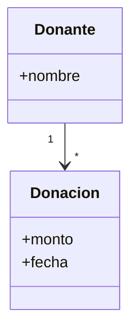

# UML y Diagramas de Dominio

Diseño de Sistemas de Información · K3003 · UTN FRBA

---

# Esta es una clase de ejemplo

Cada clase vive en su carpeta: `clases/C01-uml/slides.md`.

<v-clicks>

- Se escribe en Markdown
- Se anima con `v-click`
- Se enriquece con componentes de Vue

</v-clicks>

---

# Componentes compartidos

El componente `DataFlow` vive en `shared/components` y se puede usar en cualquier clase.

<DataFlow :nodes="['Cliente', 'API', 'Base de datos']" />

---

# Diagramas con Mermaid

